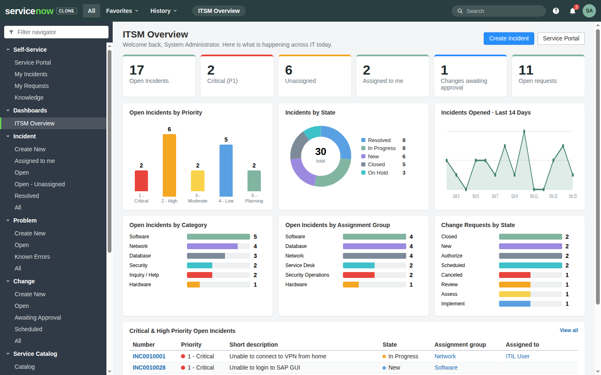
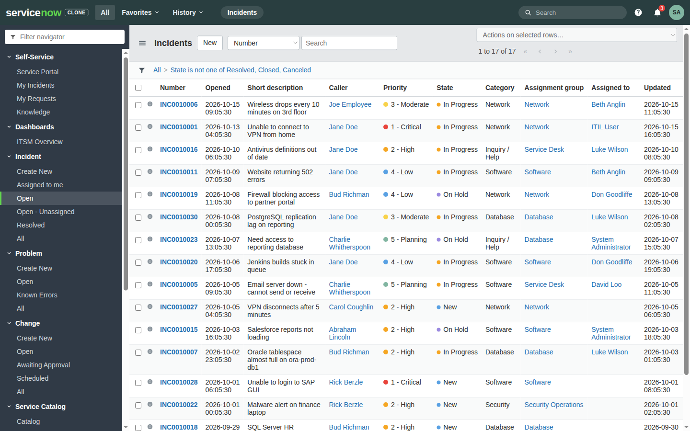
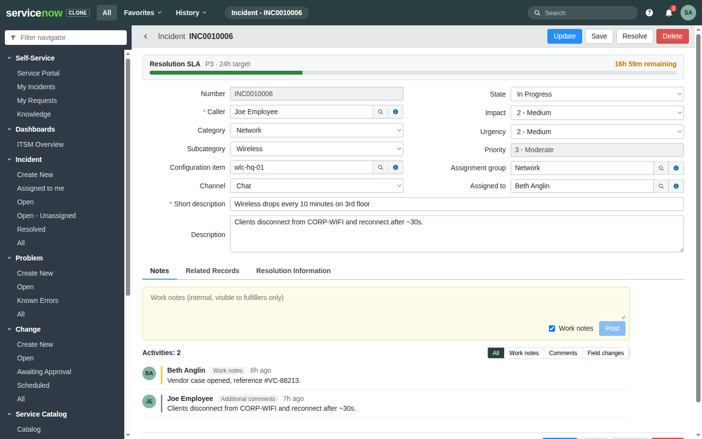
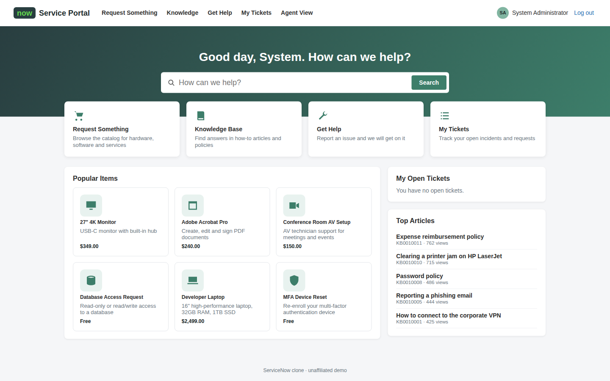

# ServiceNow Clone

A full-stack, ServiceNow-style ITSM demo app: Incident, Problem, Change, Service Catalog / Requested Items, Knowledge, CMDB, users & groups, an ITSM Overview dashboard and an end-user Service Portal.

> Unaffiliated demo built for illustration. Not a ServiceNow product and uses no ServiceNow code or assets.



## Quick start

```bash
npm install
npm run dev          # API on :3001 + Vite on :5173
```

Open http://localhost:5173 and pick a demo account (password `demo` for all):

| User | Role | Lands on |
| --- | --- | --- |
| `admin` | admin | ITSM Overview dashboard |
| `beth.anglin` | itil (agent) | ITSM Overview dashboard |
| `abel.tuter` | end user | Service Portal |

The SQLite database (`data/servicenow.db`) is created and seeded on first start. `npm run reset-db` wipes it so the next start re-seeds.

Production-style run: `npm run build && npm start` (Express serves `dist/` on :3001).

## Features

- **Classic UI**: header with All / Favorites / History menus, filterable application navigator, global search, user menu with *Impersonate user*.
- **List view**: encoded-query breadcrumbs (click to trim), condition builder (AND/OR, is / contains / is one of / empty...), quick search, column sort, right-click *Show Matching / Filter Out*, pagination, bulk *Assign to me / Delete*.
- **Form view**: two-column layout, mandatory indicators, reference fields with type-ahead lookup, dependent Category -> Subcategory, live Impact x Urgency -> Priority, SLA bar, change state stepper, form tabs, related lists.
- **Activity stream**: work notes vs. additional comments, plus automatic *field change* audit entries.
- **Business rules (server)**: auto-numbering (INC/PRB/CHG/RITM/KB), priority matrix, mandatory Resolution code/notes to resolve, auto In Progress on assignment, change approval flow (Request Approval -> Approve/Reject -> Scheduled -> Implement -> Review -> Closed), catalog orders >= $1,000 need approval.
- **Dashboard**: KPI tiles and charts that drill down into filtered lists.
- **Service Portal**: catalog with variables and ordering, Get Help (record producer to Incident), My Tickets with conversation, Knowledge Base with search and "helpful" votes.
- **Virtual Agent**: chat widget on every portal page. It answers questions with ranked Knowledge articles, opens an incident from the conversation (category, subcategory, assignment group and urgency inferred from the text, channel = Chat), reports the status of your open incidents/requests or a specific `INC…`/`RITM…` number, and suggests catalog items ("I need a new laptop"). Try: *my vpn keeps disconnecting* -> *Still need help*.

## Architecture

```
shared/schema.ts   table/field/choice metadata shared by API and UI
server/            Express 5 + node:sqlite (Node >= 22.18, run as TypeScript via type stripping)
  db.ts            schema creation, encoded-query -> SQL, CRUD, business rules, journal/audit
  app.ts           REST routes
  seed.ts          deterministic demo data
  va.ts            Virtual Agent intents, keyword ranking and incident classification
src/               React 19 + Vite + React Router
```

### REST API (ServiceNow Table API style)

| Method | Path | Notes |
| --- | --- | --- |
| GET | `/api/now/table/:table` | `sysparm_query` (encoded query, e.g. `priority=1^ORpriority=2^ORDERBYDESCopened_at`), `sysparm_limit`, `sysparm_offset`, `sysparm_text` |
| GET/PATCH/DELETE | `/api/now/table/:table/:sys_id` | PATCH also accepts `work_notes` / `comments` |
| POST | `/api/now/table/:table` | |
| GET/POST | `/api/now/journal/:table/:sys_id` | activity stream |
| GET | `/api/now/stats/:table?sysparm_group_by=field` | grouped counts |
| POST | `/api/now/catalog/:item/order` | creates a Requested Item |
| POST | `/api/now/approval/:table/:sys_id` | `{ "decision": "approved" \| "rejected" }` |
| GET | `/api/now/search?q=` | global search |
| POST | `/api/now/va/message` | Virtual Agent turn: `{ "text": "..." }` or `{ "action": { "type": "menu" \| "solved" \| "create_incident", ... } }` -> `{ messages, chips }` |

Send `X-User: <sys_id>` to act as a user (the UI does this after login). Supported query operators: `=`, `!=`, `LIKE`, `NOTLIKE`, `STARTSWITH`, `IN`, `NOTIN`, `ISEMPTY`, `ISNOTEMPTY`, `<`, `>`, `<=`, `>=`, `^OR`, `ORDERBY`/`ORDERBYDESC`, plus `javascript:gs.getUserID()` and `javascript:gs.daysAgo(n)`.

## Checks

```bash
npm run typecheck
npm run lint
npm test             # API tests (node:test, in-memory DB)
```

## Screenshots

| Incident list | Incident form | Service Portal |
| --- | --- | --- |
|  |  |  |
